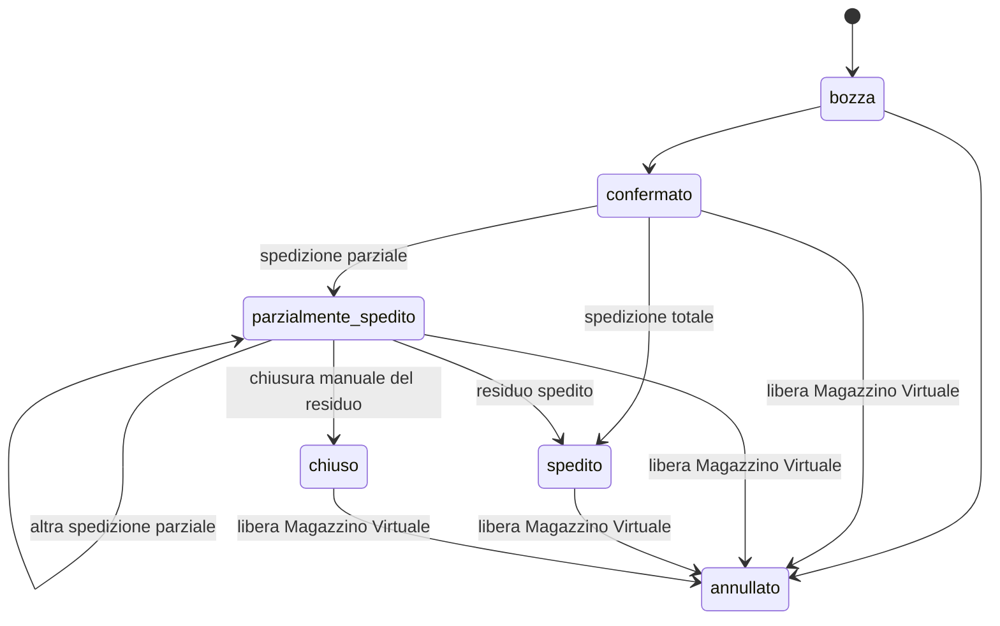

# Glossario del dominio — Cooperativa Barbatelle

Linguaggio comune del progetto: gli stessi termini si usano nei documenti (`REQUISITI.md`, `docs/adr/*`), nel database (`apps/api/src/db/schema.ts`) e negli schemi condivisi (`packages/shared`).

## Termini di Dominio

| Termine | Nel codice | Definizione |
|---|---|---|
| **Barbatella (Combinazione)** | `(varieta_id, clone_id, portainnesto_id)` | Prodotto gestito dalla cooperativa, identificato univocamente dalla tripla **Varietà + Clone + Portainnesto**. Non esistono inserimenti a testo libero fuori catalogo. |
| **Varietà** | `varieta` | Vitigno (es. *Sangiovese*, *Vermentino*, *Trebbiano*). Ha un elenco chiuso di Cloni ammessi. |
| **Clone** | `cloni` | Selezione clonale appartenente a una specifica Varietà (es. *F9*, *R24*, *VCR 4*). Nella UI è selezionabile solo dopo aver scelto la Varietà. |
| **Portainnesto** | `portainnesti` | Piede su cui è innestata la varietà/clone (es. *1103P*, *SO4*, *K5BB*, *420A*), scelto dal catalogo ufficiale. |
| **Socio (o Fornitore)** | `soci` | Socio produttore della cooperativa (o fornitore terzo) che conferisce lotti di barbatelle. |
| **Conferimento / Lotto** | `conferimenti_lotti` | Registrazione di una quantità di barbatelle messa a disposizione da un Socio per una data combinazione `Varietà + Clone + Portainnesto`, con riferimento opzionale al `codice_lotto`. Ammette rettifiche/storni per correggere errori. |
| **Ordine Cliente** | `ordini_clienti` | Ordine di acquisto da parte di un cliente della cooperativa. Lavora sulle combinazioni aggregate `Varietà + Clone + Portainnesto`, senza vincolo rigido 1:1 con i singoli lotti conferiti dai soci. |
| **Riga d'Ordine** | `righe_ordine` | Combinazione `Varietà + Clone + Portainnesto` richiesta nell'ordine, con `quantita_ordinata` e `quantita_spedita` (*di cui spedito*). |

## I 7 Indicatori Calcolati (per combinazione `Varietà + Clone + Portainnesto`)

Per ogni combinazione valida di `(varieta_id, clone_id, portainnesto_id)`:

| Indicatore | Nel codice | Formula e significato |
|---|---|---|
| **1. Prodotto (Conferito)** | `prodotto` | Somma di `quantita_conferita` in `conferimenti_lotti` (incluse eventuali rettifiche). |
| **2. Ordinato (Impegnato)** | `ordinato` | Somma delle quantità impegnate negli ordini attivi (`stato != 'annullato'` e `stato != 'bozza'`). Per gli ordini in stato `chiuso` conta solo `quantita_spedita`; per gli altri (`confermato`, `parzialmente_spedito`, `spedito`) conta `quantita_ordinata`. |
| **3. Di cui Spedito** | `spedito` | Somma di `quantita_spedita` delle righe appartenenti a ordini non `annullati`. |
| **4. Da Spedire (Residuo)** | `daSpedire` | `ordinato - spedito`: merce ordinata dai clienti ancora da consegnare. |
| **5. Rimanenza Magazzino Virtuale (Disponibile)** | `disponibileVirtuale` | `prodotto - ordinato`: quantità effettivamente **vendibile dai commerciali**. Se un ordine viene annullato, `ordinato` scende e `disponibileVirtuale` risale subito. |
| **6. Giacenza Fisica Attuale** | `giacenzaFisica` | `prodotto - spedito`: barbatelle fisicamente ancora non spedite. |
| **7. Fabbisogno Scoperto** | `fabbisognoScoperto` | `MAX(0, ordinato - prodotto)`: quantità ordinata dai clienti ma non ancora coperta dai conferimenti dei soci (visibile nel **Pannello Produttori**). |

## Ruoli Utente

| Ruolo | Nel codice | Permessi e viste |
|---|---|---|
| **Amministrazione** | `admin` | Accesso completo: Conferimenti e conversione segnalazioni soci (Vista 3), conferma prenotazioni, Ordini e Spedizioni (Vista 4), Catalogo Anagrafiche e Utenti (Vista 5), oltre a Vista 1 e Vista 2. |
| **Commerciale** | `commerciale` | **Vista 1 (Pannello Commerciali)**: consulta le disponibilità del *Magazzino Virtuale* e può **inserire una prenotazione/ordine cliente in stato `bozza`**, che l'Amministrazione poi conferma. |
| **Socio Produttore** | `produttore` | **Vista 2 (Pannello Produttori)**: consulta i **Fabbisogni Scoperti**, **segnala la propria disponibilità** per coprire uno scoperto e consulta lo **storico dei propri conferimenti**. |

## Stati dell'Ordine Cliente

- **bozza**: ordine in preparazione (non impegna ancora il Magazzino Virtuale).
- **confermato**: impegna `quantita_ordinata` nel Magazzino Virtuale (`ordinato`).
- **parzialmente_spedito**: almeno una riga ha `0 < quantita_spedita < quantita_ordinata`.
- **spedito**: tutte le righe hanno `quantita_spedita == quantita_ordinata`.
- **chiuso**: ordine parzialmente spedito il cui residuo non verrà più consegnato; impegna solo `quantita_spedita`, liberando il residuo non spedito nel Magazzino Virtuale.
- **annullato**: ordine annullato; non impegna alcuna quantità nel Magazzino Virtuale.
