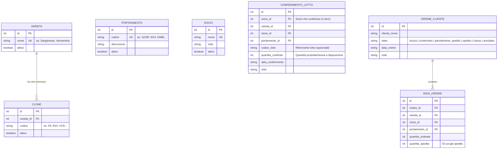

# Requisiti di Dominio e Allineamento Architetturale — Cooperativa Barbatelle

Documento di sintesi creato il 2026-10-28 per integrare lo stato attuale del progetto (`stack.md`, `GLOSSARY.md`, `docs/adr/*`) con i requisiti reali emersi dall'analisi del dominio (gestione magazzino conferimenti e ordini per una **cooperativa di produttori di barbatelle**).

---

## 1. Cosa cambia rispetto alle ipotesi iniziali (`stack.md` e `GLOSSARY.md`)

| Aspetto | Stato attuale nei `.md` | Nuovo requisito (dal vocale) | Impatto sul progetto |
|---|---|---|---|
| **Contesto e Utenti** | Uso personale, **un solo utente**, non commerciale (`stack.md`). | **Cooperativa agricola** con **3 profili**: **Amministrazione** (inserimento/gestione), **Commerciali** (lettura disponibilità per vendita), **Soci Produttori** (lettura fabbisogno scoperto). | Prevedere autenticazione multi-utente o basata su ruoli (`admin`, `commerciale`, `produttore`) e viste dedicate in sola lettura per smartphone. |
| **Prodotto / Articolo** | Articolo generico piatto con `codice`, `barcode`, `descrizione`, senza varianti (`GLOSSARY.md`). | **Barbatella**, definita univocamente dalla tripla vincolata: **Varietà** + **Clone** + **Portainnesto**. | Sostituire/affiancare il codice libero con due **tabelle d'anagrafica ufficiali** (Varietà+Cloni e Portainnesti). Il barcode passa in secondo piano rispetto ai menu a tendina vincolati. |
| **Anagrafiche vincolate** | Non presenti (inserimento libero di articoli). | **1) Anagrafica Vite** (Varietà e lista di Cloni validi per quella varietà) e **2) Anagrafica Portainnesti** (catalogo statale/ufficiale, aggiornato raramente). | Inserimento "a prova di errore": selezione a cascata **Varietà → Clone** + **Portainnesto**. Non è possibile inserire nei conferimenti o negli ordini combinazioni fuori catalogo. |
| **Entrate di magazzino** | Ordini fornitore e carichi manuali generici (`GLOSSARY.md`). | **Conferimenti dei soci** (divisi per lotti/conferimenti dei singoli soci produttori) ed eventuale acquisto da terzi per coprire gli scoperti. | I carichi rappresentano il materiale **conferito dai soci** (con riferimento al socio/lotto di conferimento). |
| **Lotti vs Ordini** | Nessun lotto (`stack.md`, `GLOSSARY.md`). | I conferimenti avvengono per **lotti**, ma **non c'è legame 1:1 tra lotto prodotto e ordine cliente**: un ordine può attingere da più lotti o prendere un "di cui" di un lotto. | Gli ordini clienti lavorano sulla combinazione **Varietà + Clone + Portainnesto** (aggregata), senza obbligare l'amministratrice a legare a priori ogni riga d'ordine a uno specifico lotto fisico. |
| **Concetto di Giacenza** | Unica `giacenza` = somma dei movimenti fisici (`ADR-0002`). | Servono **4 indicatori distinti** per combinazione: **Prodotto (Conferito)**, **Ordinato**, **Di cui Spedito**, e **Rimanenza Magazzino Virtuale** (Disponibilità commerciale). | Oltre alla giacenza fisica, va esposta la **disponibilità virtuale** (`Conferito − Ordinato attivo`) e lo **scoperto per i produttori** (`Ordinato > Conferito`). |

---

## 2. Cosa resta valido dell'architettura attuale

Lo stack scelto in [`stack.md`](./stack.md) e le decisioni in [`docs/adr/`](./docs/adr/README.md) si adattano molto bene (e risolvono i limiti riscontrati con Budibase + Supabase):

1. **PWA Angular + Cloudflare Workers/D1 (`ADR-0001`)**:
   - Risolve il problema di **Supabase gratuito** (che va in pausa dopo 7 giorni di inattività).
   - Risolve i limiti di **Budibase su mobile**: con Angular PWA i commerciali e i soci produttori possono installare l'app direttamente sulla schermata Home del telefono (Android/iOS) con un'interfaccia su misura, veloce e "a prova di errore".
2. **Saldi calcolati e tracciabilità (`ADR-0002`, `ADR-0004`, `ADR-0005`)**:
   - L'evasione parziale (`ADR-0004`: *ordinato* vs *di cui spedito*) e l'annullamento ordine che libera subito la disponibilità nel magazzino virtuale (`ADR-0005`) rispecchiano esattamente il flusso descritto nel vocale.
3. **Giacenza / Disponibilità negativa ammessa (`ADR-0003`)**:
   - Fondamentale per il **pannello Produttori**: quando l'amministrazione inserisce ordini clienti per merce che nessun socio ha ancora conferito, la disponibilità virtuale va in negativo (fabbisogno scoperto), segnalando ai soci cosa serve reperire o acquistare da terzi.

---

## 3. Modello Dati del Dominio (Revisione per Cooperativa Barbatelle)

### Formule dei calcoli chiave (per ogni combinazione `Varietà + Clone + Portainnesto`)

Per ogni combinazione valida di `(varieta_id, clone_id, portainnesto_id)`:

1. **Prodotto (Conferito)** = Somma delle quantità conferite dai soci (al netto di eventuali rettifiche/storni).
2. **Ordinato (Impegnato)** = Somma delle quantità ordinate negli ordini attivi (non `annullati`). Per gli ordini `chiusi` parzialmente, conta solo quanto effettivamente spedito.
3. **Di cui Spedito** = Somma delle quantità già spedite/evase sugli ordini attivi.
4. **Da Spedire (Residuo Ordini)** = `Ordinato − Di cui Spedito`.
5. **Rimanenza Magazzino Virtuale (Disponibile alla vendita)** = `Prodotto − Ordinato` (se `> 0`, è merce vendibile dai commerciali; se un ordine viene annullato, `Ordinato` scende e la rimanenza virtuale risale automaticamente).
6. **Giacenza Fisica Attuale** = `Prodotto − Di cui Spedito`.
7. **Fabbisogno Scoperto (per Soci Produttori)** = `MAX(0, Ordinato − Prodotto)` (quantità ordinata dai clienti ma non ancora coperta dai conferimenti dei soci).

---

## 4. Le 4 Interfacce / Pannelli richiesti

L'applicazione deve essere divisa in viste semplici, pensate per chi non è particolarmente tecnologico e consulta i dati principalmente da telefono:

### Vista 1 — Pannello Commerciali (Consultazione Disponibilità e Prenotazione Ordini)
* **Utente tipo**: Commerciale / Venditore in mobilità (smartphone).
* **Funzionamento**:
  1. Seleziona o cerca la **Varietà** (es. *Sangiovese*) da un selettore rapido con filtro testuale.
  2. Visualizza una tabella/lista di schede per tutte le combinazioni di **Clone** e **Portainnesto** con:
     - **Prodotto (Conferito)**
     - **Ordinato** (e dettaglio *di cui Spedito*)
     - **Disponibile (Magazzino Virtuale)** in evidenza (verde se disponibile, zero/rosso se esaurito).
  3. **Inserimento Prenotazione / Proposta d'Ordine (`bozza`)**: il commerciale può inserire direttamente un nuovo ordine/prenotazione per un cliente (vincolato a `Varietà → Clone + Portainnesto`), che nasce in stato `bozza` (*da confermare*) e viene poi confermato dall'Amministrazione.

### Vista 2 — Pannello Produttori / Soci (Fabbisogno Scoperto, Segnalazione Disponibilità e Storico Conferimenti)
* **Utente tipo**: Socio produttore della cooperativa (smartphone).
* **Funzionamento**:
  1. Mostra immediatamente le combinazioni (`Varietà + Clone + Portainnesto`) che sono state **ordinate dai clienti ma non ancora conferite** (`Ordinato > Conferito`).
  2. **Segnalazione Disponibilità**: su qualsiasi scoperto (o combinazione a catalogo), il socio può segnalare con un tocco quante barbatelle ha disponibili in azienda per coprire il fabbisogno. L'Amministrazione riceve la segnalazione e può convertirla in un Conferimento effettivo.
  3. **Storico Propri Conferimenti**: il socio visualizza l'elenco di tutti i lotti che ha già conferito alla cooperativa.

### Vista 3 — Pannello Amministrazione: Inserimento Magazzino (Conferimenti)
* **Utente tipo**: Amministratrice (PC / Tablet / Smartphone).
* **Funzionamento**:
  - Form guidato e vincolato per registrare i conferimenti dei soci (o acquisti da terzi):
    1. Scelta **Socio** (o fornitore terzo) e riferimento **Lotto** (se presente).
    2. Scelta **Varietà** (da catalogo).
    3. Scelta **Clone** (filtrato automaticamente sui soli cloni della varietà scelta).
    4. Scelta **Portainnesto** (da catalogo).
    5. Inserimento **Quantità** (intero positivo).
  - Possibilità di correggere/rettificare un conferimento in caso di errore.

### Vista 4 — Pannello Amministrazione: Gestione Ordini e Spedizioni
* **Utente tipo**: Amministratrice (PC / Tablet / Smartphone).
* **Funzionamento**:
  - Inserimento nuovo ordine cliente con righe vincolate a `Varietà → Clone + Portainnesto` e `Quantità ordinata`.
  - Gestione rapida dello stato dell'ordine:
    - **Registrazione spedizione** (totale o parziale: aggiorna il *"di cui spedito"*).
    - **Cancellazione / Annullamento ordine**: libera immediatamente la quantità impegnata nel **Magazzino Virtuale**, rendendola di nuovo visibile ai commerciali.

### Vista 5 (Rara) — Gestione Catalogo Anagrafiche (Vite e Portainnesti)
* **Utente tipo**: Amministratore.
* **Funzionamento**: Aggiunta occasionale di una nuova Varietà, di un nuovo Clone associato a una Varietà, o di un nuovo Portainnesto quando vengono introdotti nel registro nazionale.

---

## 5. Decisioni confermate il 2026-10-28

1. **Autenticazione per Commerciali e Soci**: **Account nominativi** divisi sui 3 ruoli (`admin`, `commerciale`, `produttore`), con possibilità opzionale di associare un account `produttore` alla propria anagrafica `SOCIO`.
2. **Dettaglio Lotti nei Conferimenti**: per ora bastano *Socio, Varietà, Clone, Portainnesto, Codice Lotto (opzionale), Quantità conferita, Data conferimento e Note*.
3. **Precaricamento Anagrafica**: al momento non c'è il dump del catalogo; si parte con un seed realistico di varietà/cloni/portainnesti viticoli e un'interfaccia/script pronto per importare il catalogo completo appena disponibile.
